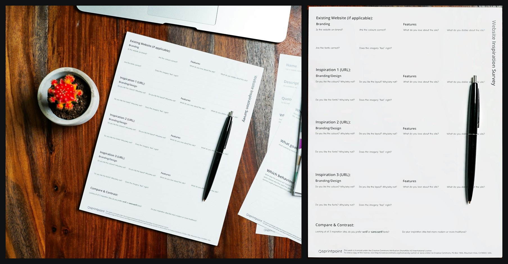

# Flash Dox — Offline Document Scanner

**Flutter · Dart · OpenCV · Google ML Kit · Android & iOS**

<p align="center">
  
</p>
<p align="center"><sub>Left: the photo as taken. Right: Flash Dox's output after automatic edge detection, perspective correction and the Auto filter.<br>Photo by <a href="https://unsplash.com/photos/a-wooden-table-topped-with-papers-and-a-pen-spScdgWY-_c">2H Media</a> on Unsplash.</sub></p>

Flash Dox is a cross-platform mobile app that turns phone photos into clean, print-ready documents. You capture or import a page, the app finds the document's edges, corrects perspective and lighting, and exports the result as a PDF, JPG or PNG. It also makes real-size ID card print sheets and passport photos, and lets you sign documents. Detection, enhancement, OCR, background removal and PDF generation all run on the device, with no server, no account and no network needed.

---

## Highlights

- Built a **production-structured Flutter app (~29,000 lines of hand-written Dart)** using **Clean Architecture** across 11 feature modules, with **BLoC** state management, **dependency injection** (`get_it` + `injectable`) and a **pure-Dart domain layer**.
- Implemented an **on-device computer-vision pipeline in OpenCV** (about 3,500 lines) covering multi-strategy edge detection, perspective warp, orientation correction, illumination correction, paper whitening, white balance, CLAHE, noise-adaptive bilateral denoising, adaptive thresholding, blur detection and person/background matting.
- **Ported a Python/NumPy image pipeline to Dart line by line** and backed it with **automated parity tests**. Every filter matches the reference to within **0.07 grey levels on average** (99th percentile ≤ 3), and the OCR and black-and-white outputs are **pixel-identical**.
- Designed a **clean-once render pipeline**: the slow step (denoising) runs once per page at export size, and every filter preview, viewer image, share and print sheet starts from that cleaned base. On a 2019 mid-range test phone, denoising had been 97 % of the time a 1-page share took (16–25 s).
- Wrote a **custom long-lived background isolate worker** with **interactive and background priority lanes**, so what the user is waiting for always runs before cache work, and the UI stays at full frame rate.
- Added a **low-RAM mode** driven by a native memory query (Kotlin / Swift), which caps render sizes and uses a cheaper denoise on clean photos on phones with ≤ 3 GB of RAM.
- Handled **48–200 MP camera sensors** without running out of memory: the app **parses JPEG headers directly** to read image size without decoding, decodes at reduced scale when the target allows, and never makes a page longer than 2000 px (~170 DPI on A4).
- Designed **non-destructive editing**. Every edit is stored as data, processed images are caches that can be rebuilt at any time, and an unfinished scan is saved as a **draft** that survives the app being killed.
- Built **native platform integrations**: an Android share-intent receiver and device channels in **Kotlin**, and an iOS **Share Extension** in **Swift**.
- Generated **true-to-size print layouts** for ID cards (ISO ID-1, 85.6 × 54 mm), passports (ID-3) and passport photo sheets (35 × 45 mm and US 2 × 2 in), with double-sided and single-page PDF output and dashed cut lines.
- Built a **testing and CI setup**: **470+ tests in 56 files** (unit, bloc, widget, large-font UI and **golden**), a database **migration test**, OpenCV benchmarks, a screen-capture harness and a **GitHub Actions** pipeline for analysis, tests and an Android build.

---

## Computer vision at a glance

All of it runs on the phone, with OpenCV called from Dart over FFI. Details are in [Image-processing engine](#image-processing-engine).

| Area | What was built |
|---|---|
| **Reference port** | A Python/NumPy pipeline ported line by line, with parity tests: **≤ 0.07 grey levels mean difference**, p99 ≤ 3, OCR and B&W **pixel-identical**. NumPy's `median`, `percentile` and `astype(uint8)` rounding re-implemented exactly so errors don't build up from step to step. |
| **Detection and geometry** | **Multi-cue document detection** (Canny edges, Otsu on LAB lightness, inverse Otsu on HSV saturation) → convex hull → `approxPolyDP` → minimum-area-rectangle fallback, scored on corner angles, area, rectangularity and expected aspect ratio. **Magnetic edges** from `HoughLinesP`, collinear-segment merging and line intersections. Perspective warp, and **orientation correction without EXIF** using the motion sensors' reading at capture time. |
| **Enhancement** | **Illumination normalisation** (dividing by an estimated paper background), gray-world white balance, CLAHE on lightness only and paper whitening, all in **float**, which removed the contour and "marble" artefacts that rounding had caused. **Noise-adaptive denoising**: σ estimated per image, a bilateral filter on luma only, chroma smoothed at ¼ size (~20× faster than the non-local means it replaced). Adaptive-threshold B&W and a separate OCR render (Google ML Kit). |
| **Quality analysis** | **Partial-blur detection** on a 3 × 3 grid: the ratio of median Laplacian to gradient on each cell's strongest edges (≈ 1/σ of the blur). A retake is suggested only when part of the page is clearly softer than the rest. |
| **Segmentation and matting** | Passport-photo background replacement: ML Kit selfie segmentation, refined at the hair line, then **blur-fusion foreground estimation** (Forte & Pitié 2021) so the old wall colour is removed from edge pixels before blending with the new background. |
| **Mobile performance** | A **clean-once render architecture**: each page is denoised once at export size, and every filter, preview and export reuses it. Denoising had been **97 %** of a 16–25 s export on a 2019 mid-range phone. A two-lane priority worker isolate, a **low-RAM mode**, explicit native `Mat` ownership checked by a test, and **JPEG header parsing + reduced-scale decoding** for 48–200 MP photos. |

---

## Features

| Area | What it does |
|---|---|
| **Capture** | Camera with Document, ID Card (front + back) and Passport modes on a fixed layout that never jumps while the camera starts. Instant shutter, steady-capture gate (waits for the gyroscope to settle), focus and exposure lock, flash, low-light hint, shutter sound and haptics. |
| **Import** | Multi-select from the gallery or Files app, plus images shared *into* the app from WhatsApp, Files and other apps (Android and iOS). |
| **Auto clean-up** | Orientation fix (even without EXIF), edge detection, perspective correction and automatic enhancement, applied to imports as well as camera shots. A check flags pages where part of the page is blurry and offers a retake. |
| **Manual adjust** | Drag corners with a magnifier loupe and **magnetic edges** that snap to detected lines and corners. Shape validation keeps the crop a valid convex quad. Rotate, retake, re-run detection. Back from Enhance returns here. |
| **Filters** | Original, Auto (colour), ID colour, Color boost, Grayscale and B&W print, with brightness and contrast sliders and *apply to all pages*. The first preview appears at once and is replaced by the full-quality result when it's ready. |
| **Documents** | Multi-page documents with smart names, folders (Bills, IDs, Education, Receipts, Office), rename, drag-to-reorder, add and delete pages. Long-press in Recent to select several documents and delete (with Undo), share or move them. |
| **Viewer** | Opens on saved 1600 px display images, so pages appear instantly and never show the unfiltered photo. Pinch to zoom, page counter. |
| **OCR** | Offline text extraction with Google ML Kit, run on a dedicated OCR-optimised render rather than the user's chosen filter. Edit, copy, or share the text as `.txt`. |
| **Export** | PDF / JPG / PNG through the system share sheet or saved to the gallery. Standard (q80) or High (q92) quality at 2000 px with a per-page size estimate, page size (Auto, A4, Letter, same as scan), layout, image size, a maximum file size, and an optional "Scanned with Flash Dox" footer. The last choices are remembered per scan type. |
| **Print layouts** | Cut-ready ID card and passport sheets at real physical size, as a double-sided PDF, a one-page PDF or an image, with a full-width swipeable preview and a front/back swap. |
| **Passport photos** | On-device background removal (ML Kit selfie segmentation + matting) with white, off-white, light blue, sky blue or dark blue backgrounds, a natural touch-up, several people on one sheet, and up to 25 photos on A4 as PDF or JPG. |
| **Signature** | Draw a signature once (smoothed with Catmull-Rom splines) or lift one from a photo, then place it on any page. |
| **Settings** | System / Light / Dark theme, scan and export defaults, footer, storage usage, privacy policy, FAQ, rate and share. |

---

## Architecture

```
presentation (pages, widgets, blocs/cubits)
        │
        ▼
domain (entities, repository contracts, use cases)   ← pure Dart, no Flutter imports
        ▲
        │
data (Drift DB, OpenCV, ML Kit, PDF implementations)
```

- **Feature-first layout.** Each feature (`documents`, `scanner`, `editor`, `ocr`, `export`, `print_layout`, `photo`, `signature`, `rewards`, `settings`, `splash`) has its own `data / domain / presentation` layers.
- **Dependency inversion for every heavy dependency.** Image processing, OCR, background segmentation, PDF building and the premium-feature gate are interfaces in the domain layer (`ImageProcessor`, `TextRecognizer`, `BackgroundSegmenter`, `PdfBuilder`, `RewardGate`) with concrete implementations in data. Each one can be swapped or mocked in tests.
- **Functional error handling.** Repositories return `Either<Failure, T>` (`fpdart`), so failures are values instead of thrown exceptions.
- **Immutable models and sealed states.** `freezed` entities, plus sealed `Idle / Working(progress) / Done / Failed` states for every long-running job.
- **Strategy pattern for scan modes.** A `ScanModeRules` object per mode defines page limits, card sides, target aspect ratio and completion rules, so widgets contain no `if (mode == …)` branches.
- **Declarative navigation.** `go_router` with a `StatefulShellRoute` for the bottom navigation, plus back-navigation guards: Camera and Adjust edges ask before discarding a scan, and drafts are autosaved.
- **Build flavors** as separate Dart entry points (`main_dev.dart` / `main_prod.dart`); dev adds bloc logging, prod silences logs.

### State management

| Type | Used for |
|---|---|
| **Bloc** (event-driven) | `ScanSessionBloc` (capture queue), `PageEditorBloc`, `ExportBloc` |
| **Cubit** (simple screens) | Home (incl. multi-select), Viewer, OCR, Print layout, Settings, Theme, Rewards |

`bloc_concurrency` transformers control how events overlap. Preview renders are debounced and `restartable`, so moving a slider quickly cancels the old render instead of queueing stale ones.

---

## Image-processing engine

The core of the app is an OpenCV pipeline of about 3,500 lines (`features/editor/data/opencv/pipeline.dart`). It is written as small synchronous functions that can be tested in isolation and run inside the background isolate.

### Capture
- **Photos kept as the camera saved them.** The scanner camera is camerawesome (a patched copy in `packages/camerawesome`): a 4:3 preview, ~8 MP photos (HD: the sensor's largest) and a separate 320 px NV21 analysis stream for the live outline. A photo is never decoded or re-encoded to make it upright: the turn it needs (`tagUpright`, from the EXIF tag and what the camera knew) is written into its EXIF orientation tag, and every read applies it.
- **Prepared while shooting.** Each photo gets a 1000 px work copy and its corners at once (on the interactive lane), then its full-quality base and first look in the background (`ScanWarmer`), so Done opens Adjust edges and Enhance on pages that are already made.
- **Partial-blur check.** `blurryRegions` scores a 3 × 3 grid on each cell's strongest edges (median |Laplacian| / |gradient|, about 1/σ for an edge blurred by σ whatever the ink's darkness). A warning needs 2 of 9 cells under 0.4 × the sharpest, which keeps false alarms rare.

### Edge detection
- Builds **several candidate binary maps** for each photo: Canny edges, bright regions (Otsu on LAB lightness), low-saturation regions (inverse Otsu on HSV saturation) and smoothed variants of both. This finds pale cards on dark tables, documents on busy backgrounds and pages in poor lighting, where edge-only detectors fail.
- Turns contours into quads through a **convex hull → `approxPolyDP` with increasing ε → minimum-area rectangle** fallback. This handles rounded card corners and slightly curled pages.
- Scores candidates on corner angles, area, rectangularity, contact with the image border and **aspect-ratio hints** (ID-1 at 1.585, ID-3 at 1.42). In card modes it searches the on-screen guide frame first.
- **Magnetic edges:** Canny + `HoughLinesP`, collinear segment merging and line intersections produce snap targets for manual corner adjustment.

### Cleaning and filters
- **Fast denoise.** A bilateral filter on luma only (YCrCb, 5 px, colour σ = strength × 6), with chroma blurred at quarter size. Strength follows the measured noise (`clamp(σ × 0.8, 3, 6)`), and a clean photo (σ < 1.5) is left alone. It replaced non-local means (round 11c), which cost ~8 s per dim-light page on a low-end phone.
- **Statistics on a sixteenth.** Every percentile, median and gray-world mean is taken on every 4th row and column, through histograms (no sorting); the whitening curve is a 1001-step lookup table.
- **Auto:** gray-world white balance → illumination normalisation (dividing by an estimated paper background) → **paper whitening** → CLAHE on lightness only → slight saturation boost, all in **float**. Rounding between steps used to draw grey "marble" patches and contour lines on plain paper; working in float removes them. Text stays crisp, and stamps and photos keep their colour.
- **ID colour:** sharp, true colours with no background whitening, because a card is not white paper.
- **B&W print:** normalise → adaptive threshold with a block size scaled to the image width → median filter, for photocopy-style output.
- **Page border clean-up:** dark slivers of desk left along the page edge are painted with the paper colour, while content that reaches deeper (a header bar, a photo printed to the edge) is kept.
- **Numerical fidelity:** custom `median` and `percentile` functions reproduce NumPy's definitions exactly, and a half-level bias makes OpenCV's rounding match NumPy's `astype(uint8)` truncation. Without these, the port drifts at each step.

### Passport photos
- ML Kit selfie segmentation gives a rough person mask; `replaceBackground` refines it at the hair line and uses **blur-fusion foreground estimation** (Forte & Pitié 2021) to take the wall's colour out of edge pixels before blending with the new background. The wide averages run on a ~320 px copy; only per-pixel steps run at full size.
- `enhancePhoto` evens light and colour, softens skin and sharpens eyes and hair. `photoSheetImage` composes JPG sheets with dashed cut lines; PDF sheets place each photo at real size.

### Render pipeline and performance
- **Clean once, reuse everywhere.** `CleanBaseService` owns one job per page and size: crop → warp → denoise → a JPEG base (q95) at export size (2000 px; no page is ever longer), plus a 1200 px copy for Enhance. Jobs are joined by whoever needs them next, promoted to the interactive lane when the user is waiting, and dropped while still queued when a page is deleted. Every filter is split into a `…From(clean)` step, so a filter change only re-runs the cheap part.
- **Size tiers.** 300 px thumbnails (q80), 1200 px Enhance previews, 1600 px viewer images (q85), Standard exports at 2000 px (q80) and High at 2000 px (q92).
- **Encode once.** Every output is JPEG-encoded a single time, and PDFs embed those JPEG bytes directly instead of decoding and re-compressing them.
- **Caches that survive saving.** Cache names are keyed on file size and modification time rather than path, so renders made while editing still match after the page moves into its document folder. Older documents get their viewer images built in the background shortly after launch.
- **Huge photos without running out of memory.** Image size is read straight from the JPEG header (no decode), and 48–200 MP photos are decoded at ½ or ¼ scale (`IMREAD_REDUCED_COLOR_*`) when the target size allows.
- **Pre-shrink before warp.** When the target is much smaller than the source, the image is downscaled with `INTER_AREA` before the perspective warp, so the warp itself never has to downsample.
- **Explicit native memory ownership.** OpenCV `Mat`s live outside the Dart GC. Every function follows a documented ownership rule (never dispose an input, always return a new Mat or the same one), and an *ownership matrix* test checks it.
- **Background capture queue.** The shutter is ready again right after `takePicture()`. Pages are processed one at a time in the background, and "Done" waits for the queue to drain.
- **Footer.** The optional "Scanned with Flash Dox" footer is vector text and a link in PDFs, and a pre-rendered mark alpha-blended onto JPG/PNG pages (`stampFooter`). It moves to the left when a signature sits in the bottom-right corner, and is never added to ID card or passport output.

---

## Data and persistence

- **Drift (SQLite)** stores documents, pages, drafts and the activity log. A **versioned schema (v4) with tested migrations** moves v1 Single/Batch rows into the Document mode and adds folders and draft pages.
- **Reactive queries.** Home watches a `Stream<List<ScanDocument>>`, so it updates on its own after any change.
- A **file store** keeps each page's upright original plus its caches in the document folder, and cleans capture and export temp files after use and on launch.
- `shared_preferences` holds user defaults (scan, export, last share choices per scan type, passport background), which the scan and export flows apply.

---

## Platform integration

- **Android:** a Kotlin `MainActivity` receives `ACTION_SEND` / `ACTION_SEND_MULTIPLE` intents (both cold start and `onNewIntent`) and passes file paths to Dart over a `MethodChannel`. Further channels report free storage (low-space warnings) and total RAM / `isLowRamDevice` (low-RAM mode).
- **iOS:** a Swift **Share Extension** target with an app group, so photos shared from other apps open in Flash Dox; `ProcessInfo.physicalMemory` feeds the same device profile.
- **Camera:** camerawesome (CameraX on Android) runs the preview, ~8 MP photos and a small analysis stream at once; a patched copy (`packages/camerawesome/FLASHDOX_PATCH.md`) honours the photo size. The camera is released when the app goes to the background and reopened on return.
- **Native splash** (`flutter_native_splash`) hands off to an in-app splash drawn at the same size and position, with night-mode-aware backgrounds.
- **Native build hook config:** the OpenCV build includes only `imgproc`, `imgcodecs` and `photo`, which keeps the binary small.
- **Permissions:** the release build asks for `CAMERA`, plus storage on Android 9 and below only (Save to phone).

---

## Monetisation and privacy

- The store release has **no ads**. The original AdMob rewarded-video integration (with UMP consent and a fail-open policy) was removed along with the `INTERNET` permission; the domain `RewardGate` stays, implemented by `UnlockAllRewardGate`, so a later monetisation model can plug in without touching the screens (see `docs/release-checklist.md`).
- Everything works with no network: no account, no uploads, no analytics on document content.

---

## Design system and UI

- **Theme tokens** and `ThemeExtension`s for full **light and dark** themes, plus a System option. Capture and editing screens stay dark on purpose.
- A **shared widget library of about 20 components** (buttons, dialogs, bottom sheets with pinned footers, segmented pills, sliders, page thumbnails, zoomable pages, dashed add-page tiles, empty/error/loading states) used across screens.
- **Custom SVG icon set** and the **Manrope** typeface (400–800 weights).
- **Localisation-ready**, with every string in ARB files compiled to `AppLocalizations`.
- **Large-font tests** render key screens at large text scales to catch cut-off text, and **golden tests** lock in the shared widgets and the brand mark.

---

## Testing and tooling

| Kind | Examples |
|---|---|
| **Unit** | Quad geometry and crop validity, print-layout and photo-sheet calculators, scan-mode rules, smart names, home sorting and selection, capture orientation, steady-capture gate, device profile, OpenCV module availability |
| **Bloc** | `ScanSessionBloc`, `PageEditorBloc`, `ExportBloc` (with `mocktail`) |
| **Integration-style** | Document repository against an in-memory Drift DB, schema migrations, drafts, isolate runner priorities, page render and clean-base services, export (share, save, footer, max file size) |
| **Image pipeline** | Reference-parity test against Python outputs, edge-detection fixtures with labelled ground-truth corners, blur check, page border, "never the raw photo" checks, print, photo and footer renders, Mat ownership matrix |
| **UI** | Large-font screen tests, camera layout and overlay, back guards, zoomable pages |
| **Golden** | Shared widget library and brand mark |
| **Benchmarks** | Tagged `bench` suite that times decode / ingest / enhance / export on 12 MP and 16 MP images and writes a before/after visual evidence sheet |

- **56 test files, 470+ test cases**, linted with **`very_good_analysis`** (strict rules).
- **GitHub Actions CI:** code generation → `flutter analyze` → `flutter test` → Android APK build, triggered on demand.
- **Code generation** with `build_runner` for `freezed`, `json_serializable`, `drift` and `injectable`.
- **Python reference tooling** (`tool/reference/`) regenerates the expected outputs for the parity tests.
- **Screen captures** (`test/tools/screens_test.dart`, tag `screens`) render every main screen to `build/screens/` for design review.

---

## Tech stack

| Category | Technologies |
|---|---|
| Language / framework | Dart 3.10, Flutter 3.38 |
| Architecture | Clean Architecture, feature-first modules, SOLID, Strategy pattern |
| State management | `flutter_bloc`, `bloc_concurrency` |
| DI / navigation | `get_it`, `injectable`, `go_router` |
| Models / errors | `freezed`, `json_serializable`, `fpdart` (`Either`) |
| Persistence | `drift` (SQLite), `shared_preferences` |
| Computer vision | OpenCV via `opencv_dart` (FFI) |
| Machine learning | Google ML Kit Text Recognition and Selfie Segmentation (on-device) |
| Documents | `pdf` (PDF generation), `flutter_svg`, `share_plus`, `gal` |
| Device | `camerawesome` (patched copy), `sensors_plus`, `image_picker`, `file_picker`, `audioplayers` |
| Native | Kotlin (Android `MethodChannel`s), Swift (iOS Share Extension, device channel) |
| Testing / CI | `flutter_test`, `mocktail`, golden tests, `very_good_analysis`, GitHub Actions |

---

## Project structure

```
lib/
├── app/              # app shell, router, DI, theme tokens, flavors, bootstrap
├── core/             # failures, use-case base, constants, services
│                     # (file store, isolate runner, device profile, prefs,
│                     #  share, save, storage, share-in)
├── shared/widgets/   # reusable component library
├── l10n/             # ARB strings → generated AppLocalizations
└── features/
    ├── documents/    # Drift DB, repository, Home (Recent, folders), Viewer
    ├── scanner/      # camera, scan modes (strategy), import, capture queue, drafts
    ├── editor/       # OpenCV pipeline, clean-base and page render services,
    │                 # Adjust edges, Enhance
    ├── ocr/          # ML Kit recogniser, extracted-text screen
    ├── export/       # PDF / JPG / PNG export, share sheet, footer
    ├── print_layout/ # real-size ID card and passport sheets
    ├── photo/        # passport photos: segmentation, crop, photo sheets
    ├── signature/    # draw / lift a signature, place it on a page
    ├── rewards/      # premium-feature gate (currently unlocks everything)
    ├── settings/
    └── splash/
```

---

## Development

The full product plan (screens, flows, domain model) is in `flash_dox_plan.md`; each round's notes are in `docs/`.

### Commands

```sh
flutter pub get
dart run build_runner build --force-jit --delete-conflicting-outputs
git checkout -- lib/features/documents/domain/entities/   # see note below
flutter gen-l10n                           # after editing lib/l10n/app_en.arb
flutter analyze && flutter test
flutter test --update-goldens test/shared  # after intentional UI changes
flutter test test/tools/screens_test.dart --tags screens --run-skipped --update-goldens

flutter run -t lib/main_dev.dart           # dev flavor: bloc logs
flutter build appbundle -t lib/main_prod.dart
flutter build apk --split-per-abi -t lib/main_prod.dart
```

- `--force-jit` is required for `build_runner` on this toolchain: `sqlite3` ships a native build hook that the AOT builder compile does not support.
- `build_runner` currently fails on `quad.dart` and deletes the generated files of the document entities; restore them with the `git checkout` line above. Edit those `.g.dart` files by hand when an entity changes (e.g. a new enum value).
- Flavors are Dart entry points (`main_dev.dart` / `main_prod.dart`), not native product flavors, so no Xcode scheme work is needed.
- Installing on a phone that has a release build: build, sign with the release key (`android/key.properties`) and `adb install -r`. A `flutter run` debug build has a different signature and Android uninstalls the app (and its documents) to install it.

### Engine notes

* **Reference port.** Detection, warp and filters are a line-by-line port of
  the owner's `tool/reference/flashdox_reference.py`
  (`features/editor/data/opencv/pipeline.dart`). `python3
  tool/reference/dump_reference.py` writes the reference's outputs for every
  photo in `test/fixtures/edges/`; `reference_parity_test.dart` checks the
  Dart port against them (mean difference < 0.3 levels, p99 ≤ 3; OCR and B&W
  print identical). Keep the two in step when either changes.
* **Provisional parts.** `cleanPageBorder` was written from a description of
  the reference's `clean_page_border()`; replace it with a straight port and a
  parity test when that code arrives. Newer detection (`_line_quads`,
  `_edge_support`) and Auto (`_paper_background`, `_text_page_strength`)
  changes are waiting on the updated reference too.
* **Render cache version.** When a change alters how saved pages look, bump
  `FileStore.renderVersion` so documents' cached images are rebuilt once.
* **Thresholds to calibrate** on real phones: `CaptureChecks.blurThreshold`
  and `darkThreshold`, and the `blurryRegions` ratio (every capture logs its
  values).
* **Logs.** `[capture]`, `[ingest]`, `[orient]`, `[step]`, `[queue]` and
  `[perf]` lines give per-step timings on a device (debug and profile builds).
  `[FD-PERF]` lines (`page=3 step=detect ms=412 in=1000x750 out=4pts
  isolate=worker`) are also written to `perf.log`; Settings → About →
  long-press the version shares it and holds four feature switches for
  timing runs (debug, profile, or a release build with
  `--dart-define=FD_TEST=true`).
* **Edge fixtures.** `test/fixtures/edges/*.jpg` + corner JSON (README
  there).
* **OpenCV modules:** `hooks.user_defines.dartcv4.include_modules` in
  pubspec — `photo` is required.
* **iOS share-in** needs a one-time Xcode step: see `ios/ShareExtension/README.md`.
* **Benchmarks / evidence:** `flutter test test/bench --tags bench
  --run-skipped` prints timings and writes `docs/round3/results_dart.jpg`.

### Notes

* Edits are non-destructive: `ScanPage.edits` is the source of truth; cleaned
  bases, display images and thumbnails are caches rebuilt by
  `CleanBaseService` and `PageRenderService`.
* All OpenCV / PDF work runs through `IsolateRunner`, one long-lived worker
  isolate with an interactive and a background queue, so two renders never
  overlap.
* `pdf` 3.12 pins `archive < 4.1`; `image` is overridden to 4.5.4 in
  `pubspec.yaml` so `flutter_native_splash` builds. Remove the override once
  `pdf` ≥ 3.13 resolves on your Dart SDK.
